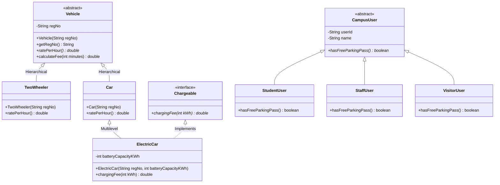

# Task 6 – Design the Inheritance Hierarchy
**Student Name:** Jaya Harish J  
**Register Number:** 192462001  
**Course Code & Title:** CSA09 – Java Programming / Object-Oriented Programming (CO1)  
**Bloom’s Level:** K4 – Analyse  
**Marks:** 4 Marks  

---

## 1. Inheritance Hierarchy Design

The model implements both **Hierarchical Inheritance** and **Multilevel Inheritance**:
1. **Hierarchical Inheritance:**
   - Abstract Superclass: `Vehicle`
   - Subclasses: `TwoWheeler` and `Car` directly extend `Vehicle`.
2. **Multilevel Inheritance:**
   - `Vehicle` (Grandparent class) $\longrightarrow$ `Car` (Parent class) $\longrightarrow$ `ElectricCar` (Derived specialization).
   - An `ElectricCar` is a specialized `Car`, which in turn is a `Vehicle`.
3. **User Affiliation Hierarchy:**
   - Base Class: `CampusUser`
   - Derived Subclasses: `StudentUser`, `StaffUser`, and `VisitorUser` implement category-specific pass privileges.

### What is Inherited vs Added in Each Subclass
- `TwoWheeler` inherits `regNo`, `getRegNo()`, `calculateFee(minutes)` from `Vehicle`; overrides `ratePerHour()` to return $Rs\ 10.0$.
- `Car` inherits all base vehicle attributes and overrides `ratePerHour()` to return $Rs\ 30.0$.
- `ElectricCar` inherits standard car attributes and slot suitability, and adds `batteryCapacityKWh`, `chargingFee(int kWh)`, and the `Chargeable` interface.

---

## 2. Constructor Execution Order Trace for `ElectricCar`

When an `ElectricCar` object is created (`new ElectricCar("TN03C3", 60)`), constructor chaining proceeds upward to `java.lang.Object` before executing downward:

```
Step 1: new ElectricCar("TN03C3", 60) called in main()
Step 2: ElectricCar constructor executes super(regNo) -> delegates to Car(regNo)
Step 3: Car constructor executes super(regNo) -> delegates to Vehicle(regNo)
Step 4: Vehicle constructor executes super() -> delegates to java.lang.Object()
Step 5: java.lang.Object constructor finishes.
Step 6: Vehicle constructor body executes: initializes regNo = "TN03C3"
Step 7: Car constructor body executes.
Step 8: ElectricCar constructor body executes: initializes batteryCapacityKWh = 60
Step 9: ElectricCar reference returned to caller.
```

### Verified Terminal Log:
```text
  [1] Vehicle constructor executed for: TN03C3
  [2] Car constructor executed.
  [3] ElectricCar constructor executed with battery capacity: 60 kWh.
```

---

## 3. UML Class Diagram



---

## 4. Alternative Concept and Complexity Analysis

### Comparison: Inheritance (`IS-A`) vs Composition (`HAS-A`)

#### Composition Design:
Instead of creating subclasses, a single `ComposedVehicle` class holds a reference to a `VehicleType` strategy object:
```java
public class ComposedVehicle {
    private final String regNo;
    private final VehicleType type; // HAS-A relationship
}
```

#### Analytical Comparison:
1. **Work Needed to Add a New Vehicle Type:**
   - **Inheritance:** Requires declaring a new subclass (`class EBike extends Vehicle`). Highly structured, type-safe, and supports compile-time method checking.
   - **Composition:** Can define a new type at runtime simply by instantiating a configuration object (`new VehicleType("EBike", 15.0, false)`). Eliminates subclass explosion.
2. **Time to Compute Fee:**
   - **Inheritance:** Invokes `v.calculateFee(minutes)` via `invokevirtual` ($O(1)$ dynamic dispatch through vtable).
   - **Composition:** Invokes `type.getRatePerHour()` via an extra object dereference ($O(1)$ indirect pointer lookup).
3. **Space per Vehicle Object:**
   - **Inheritance:** Flatter object memory layout. 1 heap object containing primitive fields and references directly.
   - **Composition:** 2 distinct heap objects (`ComposedVehicle` + `VehicleType`), incurring an additional 16-byte object header and 8-byte pointer overhead per unique vehicle (unless `VehicleType` instances are shared as Flyweights).

| Metric | Inheritance (`Car is-a Vehicle`) | Composition (`Vehicle has-a VehicleType`) |
| :--- | :--- | :--- |
| **Relationship** | Static compile-time classification | Dynamic runtime aggregation |
| **Adding New Type** | Write new subclass ($O(1)$ class) | Pass new config instance ($O(1)$ runtime) |
| **Fee Calculation Time** | $O(1)$ direct vtable dispatch | $O(1)$ pointer dereference + call |
| **Memory per Vehicle** | $\approx 32$–$40$ bytes (single object) | $\approx 64$ bytes (2 heap objects if unshared) |
| **Type Safety** | Strict compile-time typing | Loose string/enum type checking |

---

## 5. Execution and Verification
To compile and execute Task 6:
```bash
javac Task06/src/InheritanceHierarchyDemo.java
java -cp Task06/src InheritanceHierarchyDemo
```
Refer to `output.txt` for recorded verification.
